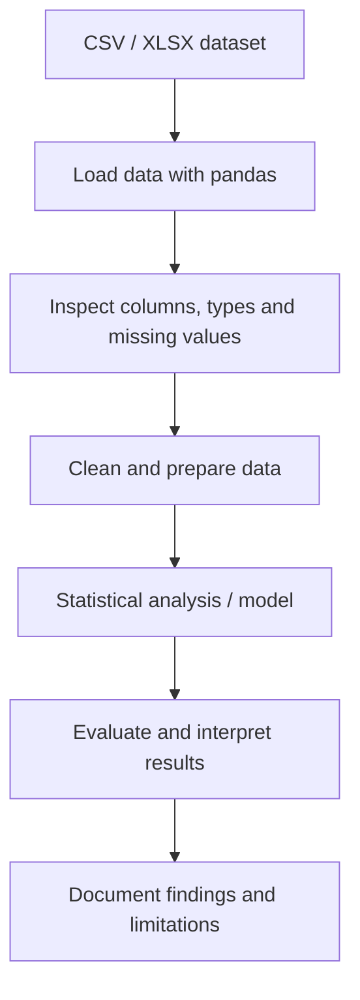

# Statistical Machine Learning — Practice Projects

This repository collects Python scripts and datasets used for statistical machine learning and data-analysis practice. The current files cover cancer-data analysis, diabetes-related analysis, housing data, and customer satisfaction/choice exercises.

> This is a collection of learning exercises rather than one packaged production application. Each script should be reviewed and run independently; dataset names and filenames reflect the current repository contents.

## Current contents

| Area | Files currently present |
|---|---|
| Cancer data | `cancer.py`, `Cancer_Data.csv` |
| Diabetes | `diabetic dataset insights.py`, `diabetes.csv` |
| Housing | `housing dataset.py`, `Housing.csv` |
| Customer satisfaction / choice | `kaggle datatset customer.py`, `manual customer satisfaction.py`, `raNDOM CHOICE CUSTOMER.py`, `Customer Satisfaction Scores and Behavior Data.xlsx` |
| Other practice scripts | `Untitled20.py`, `lab 3.py`, `ssh.py` |

Some filenames are informal or inconsistent; they are retained as-is so existing references do not break.

## Typical workflow



This is a recommended workflow for the exercises, not a claim that every existing script implements every step.

## Environment setup

### Requirements
- Python 3.10+ recommended
- pip

Create a virtual environment:

**Windows PowerShell**
```powershell
python -m venv .venv
.\.venv\Scripts\Activate.ps1
python -m pip install --upgrade pip
pip install pandas numpy matplotlib seaborn scikit-learn scipy openpyxl
```

**macOS / Linux**
```bash
python3 -m venv .venv
source .venv/bin/activate
python -m pip install --upgrade pip
pip install pandas numpy matplotlib seaborn scikit-learn scipy openpyxl
```

Run a script from the repository root, for example:

```bash
python cancer.py
python "housing dataset.py"
python "diabetic dataset insights.py"
```

Check each script's data path and imports before running it. If a script expects a file in a different directory, update the path or run it from the repository root.

## Recommended improvements

- Add a separate folder per project with its own README and clearly named entry point.
- Record each dataset's source and license.
- Add a reproducible `requirements.txt` after verifying actual imports.
- Include plots, metrics and written conclusions only when generated by the corresponding script.
- Add tests for data preparation and model evaluation.
- Rename informal filenames in a dedicated cleanup change after checking for references.

## Data and responsible use

Do not treat analysis on public or classroom datasets as evidence of clinical validity or real-world predictive performance. Document data source, target definition, train/test split, evaluation metrics and known limitations for each model.

## License

No explicit license is currently declared. Contact the repository owner before reusing the code or datasets.